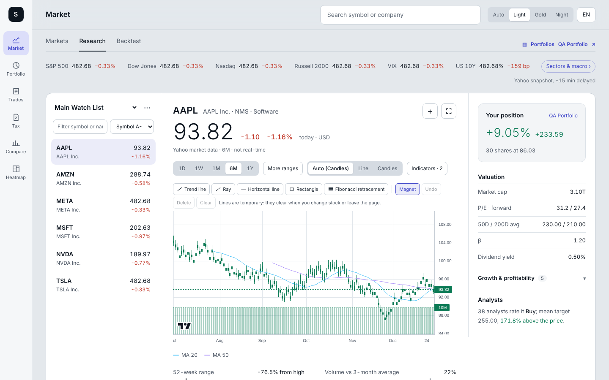
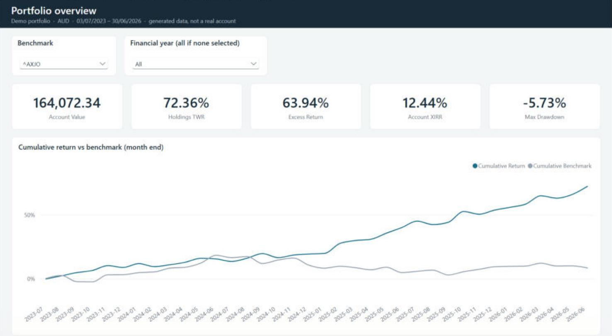
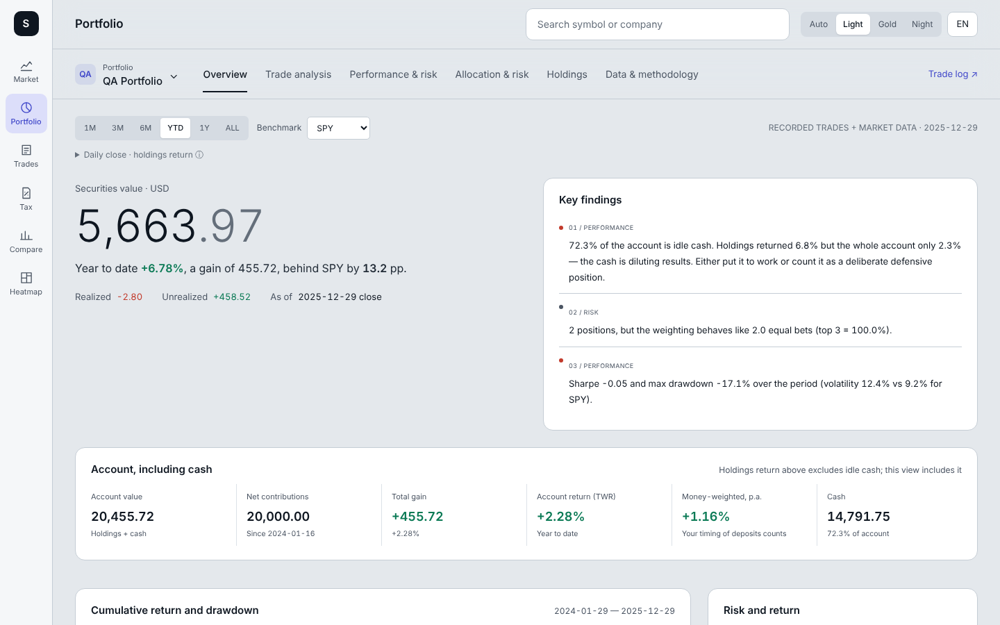
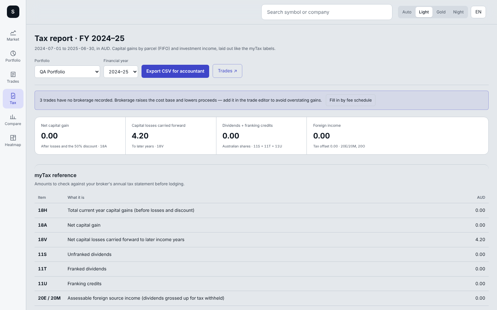
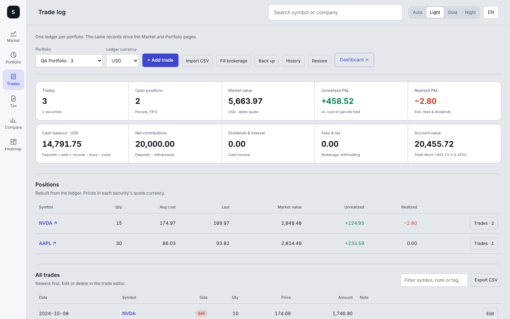
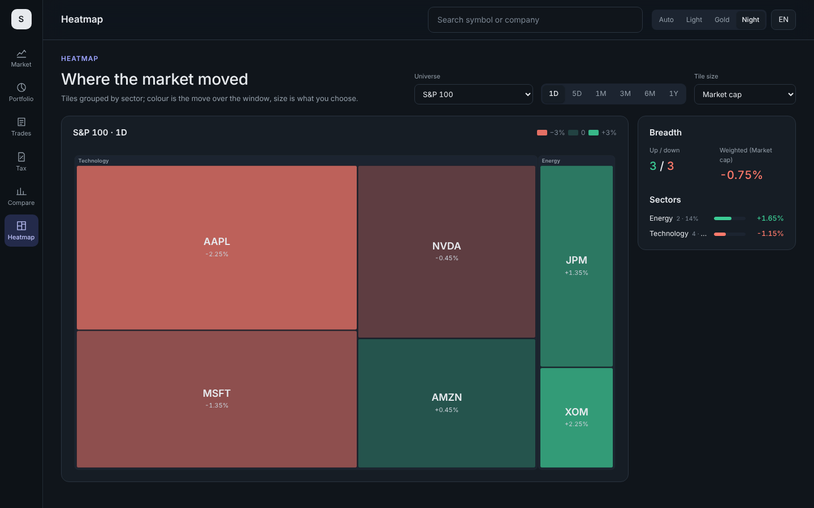

# Stock Tool

I built this to track my own share trading. I hold US and ASX stocks through a few brokers, and I wanted one place to
see how the portfolio is really doing against the index, which of my trading ideas actually make money, and what
needs to go into myTax at the end of the financial year.

It runs locally. Trades are stored in a SQLite file on your own machine, and prices come from Yahoo Finance.

All screenshots use the mock data from the test suite, not a real account.

## The data side

Most of the effort went into getting the numbers right rather than into the UI.

Prices, FX rates, splits and dividends are pulled from Yahoo for US, ASX, Hong Kong, China A-share and Korean
listings, then archived in SQLite so each refresh only fetches what is new. Before anything is calculated, past trades
are adjusted for stock splits, prices quoted in pence (GBp) are converted to pounds, and every market is put on one
trading calendar, with holidays filled from the previous close.

From there the app works out time-weighted and money-weighted (XIRR) returns, compares them with a benchmark, and
splits the result by holding, sector, holding period and my own strategy tags. The per-holding numbers add up exactly
to the total P&L, which is a useful check that nothing has been double counted.

The tax report follows the ATO rules for an individual: FIFO parcels, capital losses applied before the 50% discount,
losses carried forward, franking credits and foreign income. It exports to CSV for an accountant.

I also export the same results to a 16-table star schema and built a five-page Power BI report on it with DAX
measures. A unit test recomputes the report's headline figures from the exported tables and checks them against the
app, so the two can't quietly drift apart. Everything is in [`analytics/`](analytics/).

The calculations are covered by Vitest unit tests, and every page and main user flow by Playwright tests, all on fixed
mock data. The formulas are written up in [`docs/METHODOLOGY.md`](docs/METHODOLOGY.md) and
[`docs/TAX.md`](docs/TAX.md).

## Pages

| Page | Route | What's on it |
| --- | --- | --- |
| Market | `/` | Watch lists, line and candle charts with moving averages, quick drawings (trend lines, rectangles, Fibonacci), company facts, your position in the stock, and a moving-average backtest shown against your real trades |
| Portfolio | `/dashboard` | Holdings and account returns, benchmark comparison, contribution by holding, risk (volatility, drawdown, beta, correlation), trade stats such as win rate and profit factor, and a short list of findings |
| Trades | `/portfolio` | Trade log with brokerage and tags, FIFO parcels and realised P&L, the cash ledger (deposits, FX, dividends, interest, fees), broker CSV import, backup, restore and version history |
| Tax | `/tax` | CGT schedule by parcel for each financial year, the 12-month discount, loss carry-forward, franked and foreign dividends, the matching myTax labels, and a CSV export |
| Compare | `/compare` | Several symbols rebased to 0% on one chart |
| Heatmap | `/treemap` | S&P 100, Nasdaq-100, a watch list or your own holdings, sized by market cap or position value |

There are three colour themes, an English and Chinese interface, a phone layout, and it can be used from several
devices on the same home network without one overwriting another.

<table>
<tr><td></td><td></td></tr>
<tr><td></td><td></td></tr>
</table>

## Running it

You need [Node.js](https://nodejs.org) 22.13 or newer, which ships with SQLite built in. Older versions still run but
fall back to a plain JSON file with no version history or price archive.

On Windows you can just double-click one of the batch files. They install or update dependencies when
`package-lock.json` changes.

| To | Windows | Any OS |
| --- | --- | --- |
| use it on this computer | `start-localhost.bat` | `npm install`, then `npm run dev` |
| use it from a phone on the same Wi-Fi | `start-phone.bat` | `npm run build`, then `npx next start -H 0.0.0.0 -p 3001` |
| run all the tests | `run-tests.bat` | `npm run test:all` (`npm run test:full` also hits live Yahoo data) |

Then open <http://localhost:3000>, or the address `start-phone.bat` prints.

There is no login, so read [SECURITY.md](SECURITY.md) before opening it up beyond your own network.

## Where your data lives

Portfolios, trades, cash entries and watch lists are saved to `data/store.db` in the project folder. Earlier versions
are kept automatically, so you can roll back from Trades → History. If two devices edit at the same time, the one
working from stale data is refused rather than overwriting the other, and its version is kept in History too.
Trades → Back up downloads everything as one JSON file.

Daily prices are cached in `data/prices.db`. It can be deleted at any time and will rebuild itself. The whole `data/`
folder is git-ignored. More detail is in [docs/DATA.md](docs/DATA.md).

## Things to know

This isn't financial or tax advice. The tax logic assumes an Australian resident individual holding shares on
capital account, as described in [docs/TAX.md](docs/TAX.md). Check the figures against your broker statements, and
ask a registered tax agent if you're unsure.

Market data comes through the unofficial [`yahoo-finance2`](https://github.com/gadicc/node-yahoo-finance2) library.
That's fine for personal use, but not for anything commercial. Quotes can be delayed, and if Yahoo is unavailable the
app says so rather than showing made-up prices.

Symbols follow Yahoo's format, e.g. `AAPL`, `BHP.AX`, `0700.HK`, `600519.SS`, `005930.KS`.

## Docs

| | |
| --- | --- |
| [User guide](docs/USER_GUIDE.md) | how to use each page: recording trades, CSV import, dividends, tax |
| [Methodology](docs/METHODOLOGY.md) | how returns, risk and trade stats are calculated |
| [Australian tax](docs/TAX.md) | CGT, the discount, loss ordering, dividends, myTax labels and known limits |
| [Data & storage](docs/DATA.md) | the store, history, conflicts, backups and CSV formats |
| [Architecture](docs/ARCHITECTURE.md) | stack, data flow and a map of the code |
| [Power BI report](analytics/README.md) | the star schema, DAX measures, report pages and reconciliation |
| [Testing](docs/TESTING.md) | test layers, the requirement catalogue and CI |
| [Contributing](CONTRIBUTING.md) · [Security](SECURITY.md) · [Changelog](CHANGELOG.md) | |

## Built with

Next.js 16, React 19, TypeScript, Tailwind CSS 4, lightweight-charts, d3-hierarchy, yahoo-finance2, `node:sqlite`,
Vitest and Playwright.

## Status

Version 1.5.0. It's a personal project, shaped around how I invest (AUD ledger, US and ASX shares, IBKR, Stake and
CommSec), but issues and suggestions are welcome; see [CONTRIBUTING.md](CONTRIBUTING.md).

No licence has been chosen yet, so all rights are reserved.
