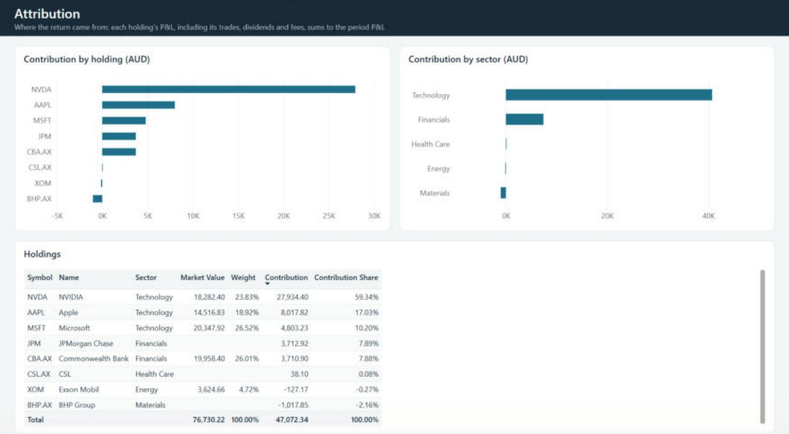
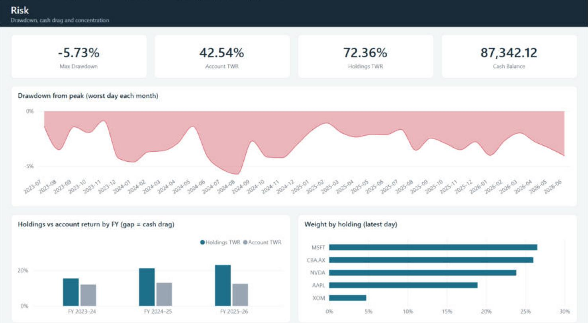
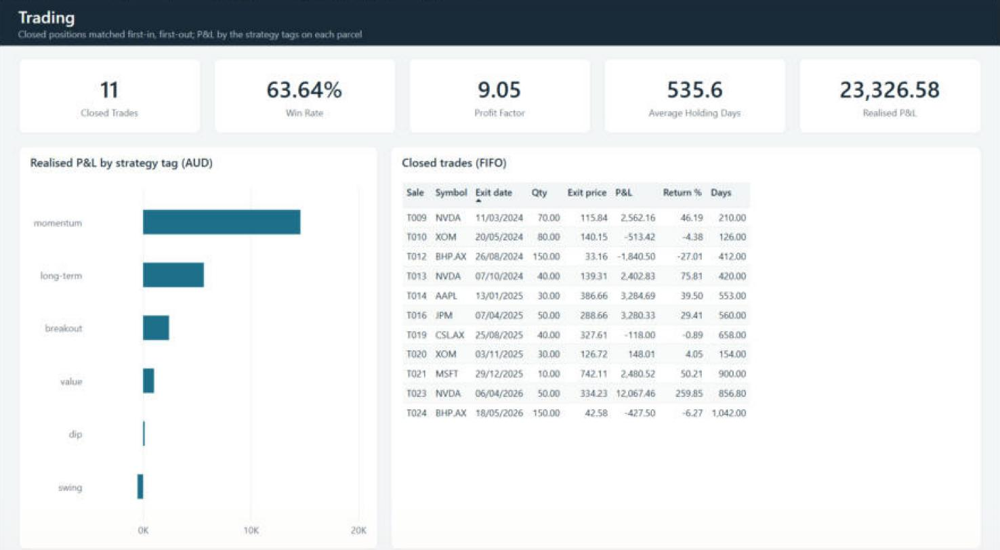
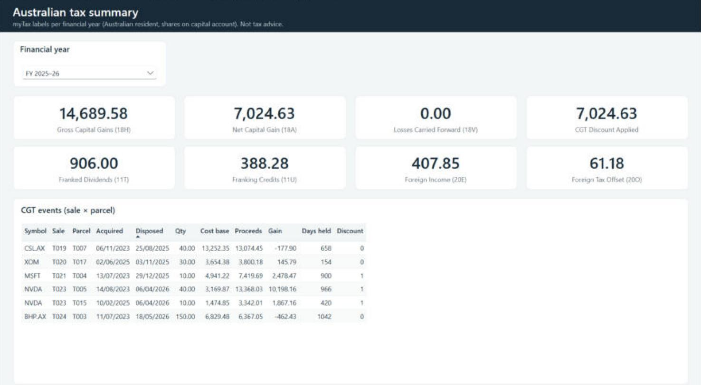

# Power BI report

A Power BI report on the same calculations as the app: performance against a benchmark, attribution, risk
and the Australian tax summary. The app's TypeScript code produces a star-schema dataset. Power BI models it
and computes the figures in DAX. A test checks that both arrive at the same numbers.

```
src/lib (returns, FIFO, tax)  ──►  analytics/bi-dataset.ts  ──►  analytics/data/*.csv  ──►  Power BI (Power Query → model → DAX)
                                          │                                                     ▲
                                          └──►  expected.json  ──►  tests/unit/bi-dataset.test.ts ┘  same formulas, same answers
```


> **Demo data only.** The portfolio is generated (seeded random prices, a scripted set of trades), so the
> report can be published openly. No real account data is involved.

## The dataset

`npm run bi:export` rebuilds everything in `analytics/data/` and `analytics/powerbi/queries.pq`. The data is
deterministic, so the committed CSVs only change when the demo changes, and a test fails if they are stale.

The demo is an Australian investor with an **AUD ledger**. They hold 5 US and 3 ASX stocks over three financial
years (FY2023–24 to FY2025–26). The history has 24 trades, partial sales across several parcels, gains held both
under and over 12 months, losses, franked ASX dividends, US dividends with 15% withholding, IBKR / CommSec
brokerage, three deposits and a withdrawal.

### Tables

| Table | Grain | Key columns | Used for |
| --- | --- | --- | --- |
| `dim_date` | calendar day | `date`, `fy`, `fy_label`, `fy_quarter`, `year_month`, `is_trading_day` | every time filter |
| `dim_financial_year` | Australian FY (Jul–Jun) | `fy`, `fy_label` | FY slicer, tax pages |
| `dim_security` | security | `symbol`, `name`, `sector`, `market`, `currency`, `is_benchmark` | slicing by holding / sector / market |
| `fact_daily_portfolio` | trading day | `value_open_aud`, `purchases_aud`, `sales_aud`, `income_aud`, `value_close_aud` | holdings TWR, P&L, drawdown |
| `fact_daily_holdings` | trading day × symbol | `quantity`, `close_aud`, `value_open_aud`, `buys_aud`, `sells_aud`, `income_aud`, `value_close_aud`, `pnl_aud` | contribution, market value, weights |
| `fact_daily_account` | trading day | `account_open_aud`, `external_flow_aud`, `holdings_aud`, `cash_aud`, `account_close_aud` | account TWR, XIRR, cash drag |
| `fact_benchmark` | trading day × benchmark | `benchmark` (`^AXJO`, `SPY`), `close_aud` | benchmark return |
| `fact_prices` | trading day × symbol | `close_local`, `fx_to_aud`, `close_aud` | price charts, FX effect |
| `fact_trades` | trade | `trade_id`, `side`, `quantity`, `price_local`, `fx_to_aud`, `value_aud`, `brokerage_aud` | trade log |
| `bridge_trade_tag` | buy × tag | `trade_id`, `tag` | tags on entries |
| `fact_cash` | cash entry | `kind`, `amount_aud` (signed), `external_flow_aud`, dividend fields | cash ledger |
| `fact_closed_trades` | sale (FIFO) | `pnl_aud`, `return_pct`, `holding_days` | win rate, profit factor |
| `bridge_closed_trade_tag` | sale × tag | `tag`, `share`, `pnl_aud` | P&L by strategy tag |
| `fact_cgt_events` | sale × parcel | `cost_base_aud`, `proceeds_aud`, `gain_aud`, `days_held`, `discount_eligible` | CGT schedule |
| `fact_tax_year` | FY | `label_18H` … `label_20O`, `losses_used`, `discount` | myTax summary |
| `fact_dividends` | dividend | `type`, `franked_aud`, `franking_credit_aud`, `withheld_aud`, `assessable_aud` | income section |

All amounts are AUD. Foreign prices are converted at each day's rate, and trades at the trade-date rate.

### Relationships

All are single-direction, one-to-many, from the dimension to the fact.

| From (one) | To (many) |
| --- | --- |
| `dim_date[date]` | `fact_daily_portfolio[date]`, `fact_daily_holdings[date]`, `fact_daily_account[date]`, `fact_benchmark[date]`, `fact_prices[date]`, `fact_trades[date]`, `fact_cash[date]`, `fact_dividends[date]`, `fact_closed_trades[exit_date]`, `fact_cgt_events[disposed]` |
| `dim_financial_year[fy]` | `dim_date[fy]`, `fact_tax_year[fy]` |
| `dim_security[symbol]` | `fact_daily_holdings`, `fact_prices`, `fact_trades`, `fact_cash`, `fact_closed_trades`, `fact_cgt_events`, `fact_dividends` (all on `symbol`) |
| `fact_closed_trades[sale_id]` | `bridge_closed_trade_tag[sale_id]` |
| `fact_trades[trade_id]` | `bridge_trade_tag[trade_id]` |

Mark `dim_date` as the date table. `fact_benchmark[benchmark]` is used only as a single-select slicer.

## Opening the report

The finished report is in [`powerbi/stock-tool.pbip`](powerbi/), saved as a Power BI Project so every table,
measure, relationship and visual is a text file that can be reviewed in git.

1. Run `npm run bi:export` (only needed if the demo changed; the CSVs are committed).
2. Open `analytics/powerbi/stock-tool.pbip` in Power BI Desktop (it needs *Power BI Project* support, on by default
   in current versions).
3. **Transform data → Edit parameters** and set `DataFolder` to the full path of `analytics\data` on your
   computer, then **Refresh**. The committed copy has a placeholder path and no cached data.
4. The DAX query view has a `Reconciliation` query that prints the figures from the table below.

The report uses its own theme, [`powerbi/theme.json`](powerbi/theme.json) (a navy header band, white cards on a light
grey page, one teal accent and red for drawdowns). Dates in tables are formatted `dd/mm/yyyy`. Chart axes use the
`year_month` column (`2024-01`) and the period is picked with a financial-year slicer, so nothing depends on the
computer's regional format.

## Building it from scratch

The same steps, if you want to rebuild the model yourself:

1. **Load the data.** In Power BI Desktop, create a text parameter `DataFolder` pointing at `analytics\data`.
   Then add one blank query per block in [`powerbi/queries.pq`](powerbi/queries.pq): the `LoadCsv` function
   first, then the 16 tables. Types are set explicitly with the en-US culture, so the report opens correctly on
   any regional setting.
2. **Model.** Create the relationships above. Mark `dim_date` as the date table and sort `fy_label` by `fy`.
   Hide the key and component columns from report view.
3. **DAX.** Add the three calculated columns and the measures from [`powerbi/measures.dax`](powerbi/measures.dax)
   (in the committed model they sit in a `_Measures` table, in display folders).
4. **Check.** Compare the figures with the reconciliation table below before building pages.
5. **Save as a Power BI Project** (File → Save as → `.pbip`) so the result stays reviewable as text.

### Pages

| Page | Visuals |
| --- | --- |
| **Overview** | Cards: Account Value, Holdings TWR, Excess Return, Account XIRR, Max Drawdown. Line: Cumulative Return vs Cumulative Benchmark by month. Slicers: benchmark (single select), financial year |
| **Attribution** | Bars: Contribution by holding and by sector. Table: symbol, name, sector, Market Value, Weight, Contribution, Contribution Share |
| **Risk** | Cards: Max Drawdown, Account TWR, Holdings TWR, Cash Balance. Area: Worst Drawdown by month. Columns: Holdings vs Account TWR by financial year (the gap is cash drag). Bar: Weight by holding |
| **Trading** | Cards: Closed Trades, Win Rate, Profit Factor, Average Holding Days, Realised P&L. Bar: Tag P&L by tag. Table of closed trades (FIFO) |
| **Tax** | Slicer: financial year (single select). Cards: 18H, 18A, 18V, CGT discount, 11T, 11U, 20E, 20O. Table: CGT events by sale and parcel |

<table>
<tr><td></td><td></td></tr>
<tr><td></td><td></td></tr>
</table>

## Reconciliation

These are the values the measures should show with no filters, for 7 Jul 2023 – 30 Jun 2026 and the `^AXJO`
benchmark. They come from the app's own code; [`data/expected.json`](data/expected.json) has full precision.

| Measure | Expected |
| --- | --- |
| Holdings TWR | 72.36% |
| Benchmark Return (`^AXJO` / `SPY`) | 8.42% / 27.11% |
| Period P&L | 47,072.34 |
| Contribution: NVDA / AAPL / MSFT / JPM / CBA.AX | 27,934.40 / 8,017.81 / 4,803.23 / 3,712.92 / 3,710.90 |
| Contribution: CSL.AX / XOM / BHP.AX | 38.10 / −127.17 / −1,017.85 |
| Max Drawdown | −5.73% |
| Account TWR (since inception) | 42.54% |
| Account XIRR | 12.45% p.a. (DAX `XIRR` uses 365-day years, so expect ±0.05 pp) |
| Account Value / Net Contributions | 164,072.34 / 117,000.00 |
| Closed Trades / Win Rate / Profit Factor / Realised P&L | 11 / 63.64% / 9.05 / 23,326.58 |
| FY 2023–24: 18H / 18A | 2,560.00 / 2,043.60 |
| FY 2024–25: 18H / 18A | 8,960.32 / 3,542.45 |
| FY 2025–26: 18H / 18A | 14,689.58 / 7,024.63 |

`tests/unit/bi-dataset.test.ts` (requirement B10) applies the DAX arithmetic to the CSVs and asserts every
row of this table, so the dataset itself is verified on every test run. The DAX syntax is checked when you load
it in Power BI.

## Publishing

- **Screenshots** of each page are in `docs/images/powerbi-*.png`.
- **Publish to web** (File → Publish → Publish to web) gives a public link anyone can open without a licence.
  Only ever publish the demo dataset this way, because the link is public.
